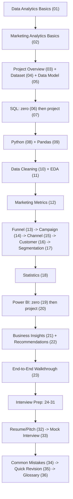

# 00 — START HERE

Welcome! Ye poora `docs/learning/` folder ek **complete beginner-to-interview-ready study book** hai, built specifically around **tumhara apna** "Marketing Intelligence & Campaign Optimization Platform" project. Isse padhne ke baad tum is project ko **kisi bhi Data Analyst interview mein confidently, bina AI pe depend kiye, explain kar sakoge.**

---

## 1. Ye Project Kya Hai (30-second version)

Ek retail company (iFood-style, real dataset) ke **2,212 customers** ka data use karke, humne dekha:
- Kaunsi 6 marketing campaigns kaam kar rahi thi, kaunsi nahi
- Kaunse customer segments zyada respond karte hain
- Web/Catalog/Store — kaunsa sales channel sabse zyada kaam kar raha hai
- Customer engagement kaha "drop off" hoti hai (funnel)
- Poore analysis ko SQL, Python (pandas/EDA), aur Power BI (planned build) se present kiya

Full detail: [03_PROJECT_OVERVIEW.md](03_PROJECT_OVERVIEW.md).

## 2. Ye Notes Kaise Use Karein

Har concept teen lenses se explain hota hai — hamesha ye order follow hota hai:

| Lens | Kya batata hai |
|---|---|
| **GENERAL CONCEPT** | Data Analytics/Marketing mein ye cheez generically kya hoti hai (koi bhi company/dataset ke liye) |
| **MY PROJECT** | Humne apne is exact project mein ye kaise use kiya — real numbers, real code |
| **INTERVIEW** | Interviewer ye kaise pooch sakta hai, aur uska strong jawab kya hoga |

**Kabhi bhi in teeno ko mix mat karna** — jaise "Conversion Rate kya hota hai" (general) alag hai "humne conversion rate kaha calculate kiya" (project) se.

Technical terms (SQL, Pandas, DAX, KPI names) hamesha **English** mein rahenge; explanation **Hinglish** mein hogi.

## 3. What Actually Exists In My Project (important — read this once)

Is poore study-book mein har jagah do cheezein clearly separate rakhi gayi hain:

- ✅ **Actually built & verified:** dataset cleaning, SQL analysis (8 files), RFM customer segmentation, funnel analysis, full Python EDA notebook (executed, real charts), statistics analysis, business insights.
- 📋 **Planned but not yet built:** a live Power BI `.pbix` dashboard. Power BI Desktop is a GUI app that couldn't be built inside this coding session — instead, a **complete, exact build specification** exists (`docs/10_powerbi_learning.md`, taught in [19](19_POWER_BI_FROM_ZERO.md)/[20](20_POWER_BI_IN_PROJECT.md)) so you can build it yourself and these notes will already match it exactly.
- ❌ **Not in this project at all, and we never pretend otherwise:** Impressions/Clicks/CTR/CPC (no ad-platform data exists), Machine Learning/clustering (segmentation is rule-based RFM, not K-Means), geographic data, campaign launch dates/time-series trends, real per-transaction financials (campaign cost/revenue use the dataset's own stated assumption constants).

Full detail in [03_PROJECT_OVERVIEW.md](03_PROJECT_OVERVIEW.md) and [04_DATASET_DEEP_DIVE.md](04_DATASET_DEEP_DIVE.md).

## 4. Full File Index

| # | File | Priority | One-line description |
|---|---|---|---|
| 00 | START_HERE.md | 🔴 MUST | This file — how to use the notes |
| 01 | DATA_ANALYTICS_FROM_ZERO.md | 🔴 MUST | What is Data Analytics, the DA workflow |
| 02 | MARKETING_ANALYTICS_FROM_ZERO.md | 🔴 MUST | Marketing terms from scratch |
| 03 | PROJECT_OVERVIEW.md | 🔴 MUST | The whole project in 30s/1min/2min/5min versions |
| 04 | DATASET_DEEP_DIVE.md | 🔴 MUST | Full data dictionary of the actual dataset |
| 05 | DATA_MODEL_AND_DATABASE.md | 🔴 MUST | Tables, keys, relationships, JOIN types |
| 06 | SQL_FROM_ZERO.md | 🔴 MUST | SELECT → window functions, from scratch |
| 07 | SQL_USED_IN_PROJECT.md | 🔴 MUST | Every real SQL query in the repo, explained |
| 08 | PYTHON_FROM_ZERO.md | 🟡 GOOD | Python basics needed for this project |
| 09 | PANDAS_FROM_ZERO.md | 🔴 MUST | DataFrame operations from scratch |
| 10 | DATA_CLEANING.md | 🔴 MUST | Every real cleaning decision made |
| 11 | EDA_AND_VISUALIZATION.md | 🔴 MUST | Every chart in the notebook, explained |
| 12 | MARKETING_METRICS_FROM_ZERO.md | 🔴 MUST | CTR, conversion rate, ROI, CAC, etc. |
| 13 | FUNNEL_ANALYSIS.md | 🔴 MUST | The real funnel, stage by stage |
| 14 | CAMPAIGN_ANALYSIS.md | 🔴 MUST | How campaigns were compared |
| 15 | CHANNEL_ANALYSIS.md | 🟡 GOOD | Web/Catalog/Store comparison |
| 16 | CUSTOMER_ANALYSIS.md | 🟡 GOOD | Customer-level behavior analysis |
| 17 | CUSTOMER_SEGMENTATION.md | 🔴 MUST | RFM segmentation, fully explained |
| 18 | STATISTICS_FROM_ZERO.md | 🔴 MUST | Mean/median/std dev/correlation etc. |
| 19 | POWER_BI_FROM_ZERO.md | 🟡 GOOD | Power BI concepts from scratch |
| 20 | POWER_BI_IN_PROJECT.md | 🟡 GOOD | The build spec, page by page |
| 21 | BUSINESS_INSIGHTS.md | 🔴 MUST | Every real insight, with evidence |
| 22 | BUSINESS_RECOMMENDATIONS.md | 🔴 MUST | Insight → recommendation, properly hedged |
| 23 | END_TO_END_PROJECT_WALKTHROUGH.md | 🔴 MUST | The full pipeline, start to finish |
| 24 | PROJECT_INTERVIEW.md | 🔴 MUST | Project-specific Q&A bank |
| 25 | DA_INTERVIEW_PREP.md | 🟡 GOOD | General fresher DA interview prep |
| 26 | SQL_INTERVIEW_PREP.md | 🔴 MUST | SQL interview questions |
| 27 | PYTHON_INTERVIEW_PREP.md | 🟡 GOOD | Python/Pandas interview questions |
| 28 | POWER_BI_INTERVIEW_PREP.md | 🟢 OPTIONAL | Power BI interview questions |
| 29 | STATISTICS_INTERVIEW_PREP.md | 🟡 GOOD | Stats interview questions |
| 30 | MARKETING_ANALYTICS_INTERVIEW.md | 🔴 MUST | Marketing-specific interview questions |
| 31 | PROJECT_DEFENSE.md | 🔴 MUST | Hard follow-up questions, defended |
| 32 | RESUME_AND_PROJECT_PITCH.md | 🔴 MUST | 30/60/120-second pitches, resume bullets |
| 33 | MOCK_INTERVIEW.md | 🟡 GOOD | A full simulated interview |
| 34 | COMMON_MISTAKES.md | 🔴 MUST | Mistakes to avoid saying out loud |
| 35 | QUICK_REVISION.md | 🔴 MUST | 30-45 minute pre-interview revision sheet |
| 36 | GLOSSARY.md | 🟡 GOOD | A-Z term reference |

## 5. Recommended Study Order

## 6. Study Priority Legend

- 🔴 **MUST KNOW** — a fresher DA interviewer will very likely ask this; you must be fluent.
- 🟡 **GOOD TO KNOW** — commonly asked, strengthens your answer, but not asking this is fine.
- 🟢 **OPTIONAL** — nice depth, low probability of being asked at entry-level.

## 7. Learning Roadmap

### 7-Day Plan (fast, interview-imminent)

| Day | Study | Practice |
|---|---|---|
| 1 | 01, 02, 03, 04 | Explain the project out loud in 1 minute |
| 2 | 05, 06, 07 | Re-run 2-3 SQL queries yourself, explain each clause |
| 3 | 08, 09, 10 | Open the notebook, re-run every cell, explain each pandas call |
| 4 | 11, 12, 18 | Re-explain every chart + every KPI formula from memory |
| 5 | 13, 14, 15, 16, 17 | Explain the funnel and RFM segmentation without notes |
| 6 | 21, 22, 23 | Write your own 1-paragraph summary of the top 3 insights |
| 7 | 24, 31, 32, 34, 35 | Full run-through of the project-interview question bank |

### 14-Day Plan (balanced depth)

| Days | Focus |
|---|---|
| 1-2 | 00-04 (foundations + project overview) |
| 3-4 | 05-07 (data model + SQL, practice re-running queries) |
| 5-6 | 08-11 (Python/Pandas/Cleaning/EDA, re-run the notebook) |
| 7-8 | 12-17 (marketing metrics, funnel, campaign, channel, customer, segmentation) |
| 9 | 18 (statistics) |
| 10 | 19-20 (Power BI — build it yourself following the spec if time allows) |
| 11 | 21-23 (insights, recommendations, full walkthrough) |
| 12 | 24-30 (all interview-prep banks) |
| 13 | 31-33 (defense, pitch, mock interview — do the mock interview out loud) |
| 14 | 34-36 (mistakes, revision sheet, glossary) — final polish |

### 30-Day Plan (deep mastery, good for a career switcher)

| Week | Focus |
|---|---|
| 1 | 00-07 — foundations, project overview, dataset, data model, all SQL (re-run every query yourself, try modifying them) |
| 2 | 08-11 — Python/Pandas from scratch, re-build parts of the notebook yourself without copying, understand every cleaning decision |
| 3 | 12-20 — every marketing metric, funnel, campaign, channel, customer, segmentation, statistics, and Power BI (actually build the dashboard this week) |
| 4 | 21-36 — insights, recommendations, full walkthrough, then all interview prep + mock interview + revision, repeated twice |

## 8. What You Should Be Able to Do After Finishing These Notes

- [ ] Explain the project in 30 seconds, 1 minute, and 5 minutes, without reading from notes.
- [ ] Explain any single SQL query in the repo, clause by clause.
- [ ] Explain any single pandas operation in the notebook, and why it was needed.
- [ ] Define every marketing metric used (and 5 not used but commonly asked) with a formula and example.
- [ ] Explain the funnel, where the biggest drop-off is, and why we can't claim its cause.
- [ ] Explain the RFM segmentation logic well enough to re-derive it on a whiteboard.
- [ ] State 3 real business insights with their evidence, and 3 recommendations, correctly hedged (no fake causation).
- [ ] Answer "what are the limitations of your project?" honestly and specifically.
- [ ] Survive a 45-minute mock interview covering SQL, Python, marketing metrics, and the project itself.

---
*Next: [01_DATA_ANALYTICS_FROM_ZERO.md](01_DATA_ANALYTICS_FROM_ZERO.md)*
