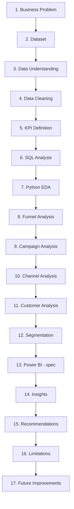

# 23 — End-to-End Project Walkthrough

🔴 MUST KNOW — this is your "explain the whole project" master reference.

## The Full Pipeline

## 1. Business Problem

"We've run 6 campaigns and have 2,212 customers' worth of purchase history, but no structured way to tell which campaigns/segments/channels are worth investing in again." → [03_PROJECT_OVERVIEW.md](03_PROJECT_OVERVIEW.md)

## 2. Dataset

Real, public "Customer Personality Analysis" (iFood) dataset — 2,240 raw rows, 29 columns, CC0 license. **Why this dataset:** genuinely real, has actual campaign/revenue/channel data (many alternatives lacked one of these), small enough to fully understand, has real data-quality problems (honest cleaning material). → [04_DATASET_DEEP_DIVE.md](04_DATASET_DEEP_DIVE.md)

## 3. Data Understanding

Column-by-column data dictionary, data types, missing values, duplicates, PK/FK identification — **done before any cleaning or analysis**, because you can't safely clean or query data you don't understand. → [04_DATASET_DEEP_DIVE.md](04_DATASET_DEEP_DIVE.md), [05_DATA_MODEL_AND_DATABASE.md](05_DATA_MODEL_AND_DATABASE.md)

**Why this comes before cleaning:** you can't decide how to fix a problem until you've precisely identified what and how big it is.

## 4. Data Cleaning

5 real issues fixed (impossible ages, missing income, income outlier, inconsistent categories, text-typed dates) — 2,240 → 2,212 rows. → [10_DATA_CLEANING.md](10_DATA_CLEANING.md)

**Why clean before analyzing:** any SQL/Python analysis run on dirty data (impossible ages, outlier incomes, inconsistent category labels) would silently produce wrong or misleading numbers — cleaning first means every later number can be trusted.

## 5. KPI Definition

Every metric formally defined with a formula BEFORE being calculated anywhere — Campaign Acceptance Rate, ROI, CAC, Channel Share, etc. → [12_MARKETING_METRICS_FROM_ZERO.md](12_MARKETING_METRICS_FROM_ZERO.md)

**Why define KPIs before querying:** prevents inconsistent, ad-hoc definitions of "conversion rate" appearing differently in different queries/charts later.

## 6. SQL Analysis

8 `.sql` files, from basic `SELECT`/`GROUP BY` to CTEs and window functions, run against a SQLite star schema. → [06_SQL_FROM_ZERO.md](06_SQL_FROM_ZERO.md), [07_SQL_USED_IN_PROJECT.md](07_SQL_USED_IN_PROJECT.md)

**Why SQL specifically:** SQL is the industry-standard way to query structured, relational data efficiently — and demonstrating real SQL (joins, CTEs, window functions) is itself a core Data Analyst skill employers check for.

## 7. Python EDA

A fully executed Jupyter notebook — distributions, categorical breakdowns, campaign/channel/segment charts, correlation heatmap, funnel chart, boxplots. → [09_PANDAS_FROM_ZERO.md](09_PANDAS_FROM_ZERO.md), [11_EDA_AND_VISUALIZATION.md](11_EDA_AND_VISUALIZATION.md)

**Why Python in addition to SQL:** SQL is great at precise aggregation; Python/matplotlib is better at *visual* shape/distribution/relationship exploration, and pandas lets you iterate quickly without rewriting queries. They're complementary, not redundant — and the Phase 7 correlation heatmap genuinely added a new, quantified insight (income ↔ web-visits = -0.65) beyond what the SQL alone showed.

## 8. Funnel Analysis

Total → Purchase → Deal-use → Campaign-accept, with a real self-caught correction (the originally-planned visit-vs-purchase funnel was invalid due to a time-window mismatch). → [13_FUNNEL_ANALYSIS.md](13_FUNNEL_ANALYSIS.md)

## 9. Campaign Analysis

Best/worst acceptance rates, profitability under the assumption constants, serial responders. → [14_CAMPAIGN_ANALYSIS.md](14_CAMPAIGN_ANALYSIS.md)

## 10. Channel Analysis

Web/Catalog/Store volume share and never-used gaps. → [15_CHANNEL_ANALYSIS.md](15_CHANNEL_ANALYSIS.md)

## 11. Customer Analysis

Demographic breakdowns, responder-vs-non-responder value comparison, VIP identification. → [16_CUSTOMER_ANALYSIS.md](16_CUSTOMER_ANALYSIS.md)

## 12. Segmentation

RFM (Recency/Frequency/Monetary) quartile-based segmentation into 4 named, business-validated segments — no ML. → [17_CUSTOMER_SEGMENTATION.md](17_CUSTOMER_SEGMENTATION.md)

**Why segmentation comes after the individual analyses (campaign/channel/customer):** segmentation synthesizes signals already discovered in those analyses (e.g., Recency's predictive value was *proven* in the campaign analysis's SQL, before being formally built into the RFM model) — it's the natural next step once you know which behavioral fields actually matter.

## 13. Power BI (specification stage)

A complete build spec — not yet built in Power BI Desktop. → [20_POWER_BI_IN_PROJECT.md](20_POWER_BI_IN_PROJECT.md)

**Why Power BI in addition to SQL/Python:** SQL/Python outputs are for technical audiences; Power BI exists to make the same insights self-service and interactive for business stakeholders who don't write code.

**Why not use only one tool, generally:** each tool has a different strength — SQL for precise relational querying, Python for flexible exploration/visualization/statistics, Power BI for interactive business-facing presentation. Using only one would mean compromising on one of those three needs.

## 14. Insights

11 documented, evidence-backed findings. → [21_BUSINESS_INSIGHTS.md](21_BUSINESS_INSIGHTS.md)

## 15. Recommendations

7 hedged, insight-grounded suggestions. → [22_BUSINESS_RECOMMENDATIONS.md](22_BUSINESS_RECOMMENDATIONS.md)

## 16. Limitations (stated openly)

- Single-company, single-time-period dataset — no cross-company/industry generalization.
- "Channel" = sales channel, not ad/acquisition channel — no CTR/Impressions data exists.
- Campaign Cost/Revenue use the dataset's own stated assumption constants, not real per-transaction financials.
- No campaign launch/end dates — no real calendar time-series trend analysis possible.
- Currency unit unspecified in source — figures are "monetary units," never assigned a currency symbol.
- No controlled experiments were run — every finding is observational (association), never proven causation.
- Power BI dashboard is a specification, not yet physically built.

## 17. Future Improvements

- Build the Power BI dashboard from the spec, capture real screenshots.
- If real campaign cost/revenue data became available, redo the ROI/CAC analysis with actual figures instead of the assumption constants.
- If campaign dates became available, add real time-series trend analysis.
- Run an actual A/B test (e.g., segment-targeted vs. broadcast campaign) to convert key associations into tested causal claims.
- Explore combining family-size with RFM segments (Insight 8) as a richer segmentation model — still rule-based, no ML needed.

## INTERVIEW

**Q: "Poora project end-to-end explain karo."**
> Use this file's 17 stages as your mental outline — Business Problem → Dataset → Understanding → Cleaning → KPIs → SQL → Python EDA → Funnel → Campaign → Channel → Customer → Segmentation → Power BI (spec) → Insights → Recommendations → Limitations → Future Improvements.

**Q: "Aapne SQL aur Python dono kyun use kiye — ek hi kaafi nahi tha?"**
> "Dono complementary hain — SQL precise aggregation/relational querying ke liye best hai, Python visual exploration aur statistics ke liye zyada flexible hai. Actually dono se same numbers cross-check bhi hue (jaise campaign ROI SQL aur notebook dono mein match karta hai) — ye apne aap mein ek quality-check hai."

**Q: "Cleaning se pehle analysis kyun nahi kar sakte?"**
> "Kyunki dirty data (impossible ages, outliers, inconsistent labels) silently galat numbers de sakta hai — jaise agar Income ka 666,666 wala outlier reh jaata, averages aur RFM thresholds distort ho jaate."

## What I Should Remember

1. The 17-stage pipeline order isn't arbitrary — each stage depends on the previous one being done correctly first.
2. SQL, Python, and Power BI each serve a genuinely different purpose — not redundant tool-stacking.
3. Limitations are stated openly, not discovered reluctantly under interview pressure.

---
*Next: [24_PROJECT_INTERVIEW.md](24_PROJECT_INTERVIEW.md)*
